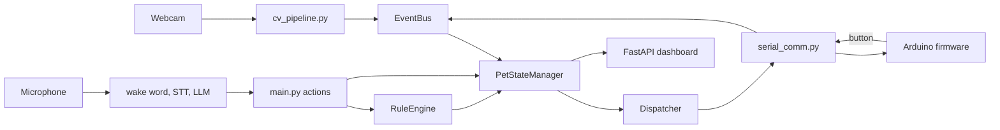

# Imposture

Imposture is a desk pet that watches you through a webcam. It notices when you slouch, pick up your phone, or put your head down, and reacts with faces on a small LCD, lights, sounds and voice. You can also talk to it to set rules or start a focus timer. In the code the pet is called Wamm.

Built at YHack 2026 ([Devpost](https://devpost.com/software/imposture-krvg9h)) by Arianne Guisadio, Will Wands, Maeve Hong and Michael Li.

## How it works

The Python app runs on a computer (a Raspberry Pi or a Mac) with a webcam and a microphone. An Arduino connected over USB drives the physical parts: the LCD face, an LED ring, a buzzer, a vibration motor and a button.



1. **Startup** (`src/main.py`). Loads settings from `.env`, creates every subsystem, connects to the Arduino, and starts the camera loop, the wake word listener, the dashboard server and a once-a-minute timer thread. Each one runs in its own background thread.

2. **Camera loop** (`src/cv_pipeline.py`). Reads frames from the webcam and rotates them 90 degrees, because the camera is mounted sideways on the device. Frames are captured continuously for the live preview, but pose and phone analysis only runs once per second. Two MediaPipe models do the work:
   - The **Pose Landmarker** finds body points (nose, ears, shoulders, hips). From those the code works out five posture features: spine angle, neck angle, how far the ears sit in front of the shoulders, and how level the shoulders and ears are. The three distance features are divided by shoulder width so they do not depend on how far you sit from the camera.
   - The **Object Detector** (EfficientDet-Lite0) looks for objects labeled "cell phone", "mobile phone" or "remote" in the frame.

3. **Posture scoring**. The features become a 0 to 100 score. Without calibration the score comes from fixed geometry rules. With calibration, the user sits up straight while the app averages 60 frames into a personal reference pose (saved to `data/calibration.json`). The score then mostly measures how far you have drifted from your own good posture, with a smaller share still coming from the fixed rules. This matters because everyone's "straight" looks a bit different on camera.

4. **Turning readings into events**. Small tracker classes in `cv_pipeline.py` watch the readings over time and turn them into events:
   - `PostureStrikeTracker` emits `POSTURE_BAD` once when the score drops below 70, and `POSTURE_GOOD` once when it recovers.
   - `PhoneTracker` emits `PHONE_DETECTED` on every check while a phone is in view, so the pet keeps alerting until it is put away, then emits `PHONE_AWAY` once.
   - `SleepTracker` emits `SLEEPING` if your head stays down for a few seconds (nose near shoulder height or a steep neck angle), and `AWAKE` when you sit back up.

   Events go through `src/events.py`, a small thread-safe publish/subscribe bus. This keeps the camera, voice, serial and timer code separate from the code that decides how the pet reacts.

5. **Pet state** (`src/pet_state.py`). `PetStateManager` subscribes to the events and keeps the pet's mood, XP, focus-session status and daily violation counts. Bad posture makes it concerned or sad and costs XP, a phone makes it angry and costs more XP, and focus time earns XP every minute. State is stored as an immutable dataclass, replaced on every change, and saved to `data/pet_state.json` so it survives a restart.

6. **Rules** (`src/rules.py`). Users can add rules such as "don't let me use my phone" with a type (posture, phone, timer or custom) and a severity (gentle, moderate or strict). Rules are saved in `data/rules.json`. When a phone event comes in, the strictest matching active rule sets how strong the alert is. Posture events carry their own severity from the camera tracker.

7. **Talking to the hardware** (`src/dispatcher.py`, `src/serial_comm.py`). The dispatcher turns a mood or an alert into hardware commands: which face to show, an LED animation, a buzzer pattern and how long to vibrate. Higher severity means a longer buzz, vibration and flashing LEDs. `SerialComm` sends each command as one line of JSON over USB at 9600 baud, and finds the Arduino's port on its own if none is set. It also reads lines coming back, so a button press on the device becomes a `BUTTON_PRESS` event that cycles the LCD through XP and focus-time screens.

8. **Arduino firmware** (`arduino/buddy_firmware/buddy_firmware.ino`). Runs on an Arduino Uno. It reads JSON lines from serial with a few small string helpers instead of a full JSON library. It draws text faces like `(^_^)` on a 16x2 LCD and drives 12 NeoPixel LEDs, a buzzer and a vibration motor. Every animation and timer is non-blocking (based on `millis()`), so the board keeps reading commands while LEDs pulse or the buzzer plays.

9. **Voice commands**. When the wake word is heard, the app handles one spoken request:
   - `src/wake_word.py` listens to the microphone with openWakeWord. It uses the built-in "hey jarvis" model as a stand-in, since there is no ready-made model for the pet's name.
   - The wake word listener pauses so it frees the microphone. `src/stt.py` records until about two seconds of silence, wraps the audio in a WAV header and sends it to Deepgram for transcription.
   - `src/llm_processor.py` sends the text to an OpenAI-compatible chat API (through the Lava gateway). The system prompt includes the pet's XP and active rules, and asks for a JSON reply with an action (`add_rule`, `remove_rule`, `start_timer`, `start_pomodoro`, `stop_timer` or `respond`) plus a short spoken reply.
   - `src/main.py` carries out the action, for example by adding a rule or starting a 25 minute focus and 5 minute break Pomodoro timer that counts down on the LCD.
   - `src/tts.py` speaks the reply with ElevenLabs. Common phrases can be saved as MP3 files in `assets/audio/` so they play without an API call.

10. **Web dashboard** (`src/dashboard/`). A FastAPI app serves a landing page at `/` and a dashboard at `/dashboard`. A WebSocket at `/ws` pushes the pet state and the latest posture numbers once a second. The page shows the live camera feed with the skeleton and phone boxes drawn on top (`/api/camera_frame`). It also uses REST endpoints to add, toggle and delete rules, start or stop focus sessions, run calibration and reset everything.

## Project layout

```
src/
  main.py            starts everything, handles voice actions and timers
  cv_pipeline.py     webcam capture, MediaPipe pose and phone detection, trackers
  events.py          thread-safe event bus
  pet_state.py       mood, XP and focus state, saved to JSON
  rules.py           user rules, saved to JSON
  dispatcher.py      maps moods and alerts to hardware commands
  serial_comm.py     JSON-over-serial link to the Arduino
  wake_word.py       openWakeWord listener
  stt.py             microphone recording + Deepgram transcription
  llm_processor.py   LLM call that turns speech into an action
  tts.py             ElevenLabs speech + phrase cache
  dashboard/         FastAPI app, Jinja2 templates, CSS and JS
arduino/buddy_firmware/  Arduino Uno firmware (LCD, NeoPixels, buzzer, motor, button)
tests/               pytest tests for the event bus, rules, pet state and posture scoring
posture_analyzer8.py standalone posture script (OpenCV window) that the pipeline grew from
test_camera_lcd.py   hardware check: webcam to Arduino LCD
test_real_cv.py      hardware check: real posture pipeline to Arduino LCD
setup.sh             creates a venv, installs dependencies, downloads the models
```

## Tech stack

- Python: OpenCV, MediaPipe (Pose Landmarker, Object Detector), NumPy
- FastAPI, Uvicorn, Jinja2, WebSockets, Pydantic
- openWakeWord, sounddevice, pydub
- Deepgram (speech to text), ElevenLabs (text to speech), OpenAI Python SDK pointed at the Lava gateway
- pyserial, python-dotenv
- Arduino (C++): LiquidCrystal, Adafruit NeoPixel
- Plain HTML, CSS and JavaScript for the dashboard

## Running it

You need a webcam, a microphone, and an Arduino Uno wired to a 16x2 LCD, a NeoPixel ring, a buzzer, a vibration motor and a button (pin numbers are at the top of the `.ino` file).

1. Flash `arduino/buddy_firmware/buddy_firmware.ino` with the Arduino IDE. Install the Adafruit NeoPixel library first; LiquidCrystal comes with the IDE.

2. Run the setup script. It creates `venv/`, installs `requirements.txt`, installs PortAudio (apt or Homebrew), copies `.env.example` to `.env`, and downloads `pose_landmarker.task` and `object_detector.tflite` from Google's MediaPipe model storage:

   ```bash
   ./setup.sh
   ```

3. Fill in `.env`. Variable names:
   - `DEEPGRAM_API_KEY`
   - `ELEVENLABS_API_KEY`, `ELEVENLABS_VOICE_ID`
   - `LAVA_API_KEY` (or `OPENAI_API_KEY`), `LAVA_BASE_URL` (leave empty to call OpenAI directly), optional `LLM_MODEL`
   - optional: `ARDUINO_SERIAL_PORT`, `ARDUINO_BAUD_RATE`, `WEBCAM_INDEX`, `WAMM_HOST`, `WAMM_PORT`, `AUDIO_INPUT_DEVICE`, `AUDIO_OUTPUT_DEVICE`

4. Start the app:

   ```bash
   source venv/bin/activate
   python -m src.main
   ```

   The dashboard is at `http://localhost:8080/dashboard`. Use the calibrate button there to record your reference posture.

To run the tests:

```bash
pip install pytest
python -m pytest tests
```
